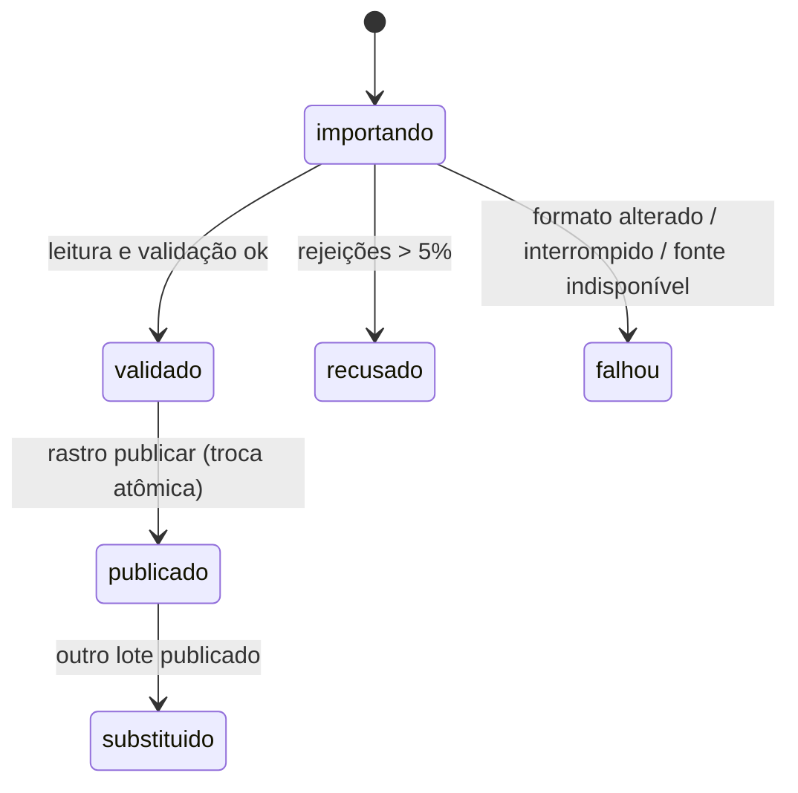

# ADR-0001 · Publicar dados por lote imutável com troca atômica do lote ativo

- **Status:** aceita
- **Data:** 26/10/2026
- **Requisitos ligados:** REQ-05, REQ-06, REQ-07, REQ-09, REQ-10, REQ-14

## Contexto

- O pacote da CGU é substituído inteiro a cada atualização e pode mudar sem aviso (FI-01 §10.3).
- A regra de confiança do brief exige que todo valor exibido aponte para a sua origem.
- Uma consulta feita durante uma atualização não pode misturar dados de duas versões (FI-01 §10.1, AC-3).
- A funcionalidade de linha do tempo precisa dos valores antigos, então atualizar linha a linha apagaria a história.

## Opções consideradas

1. **Upsert linha a linha** na tabela de emendas, guardando a "última versão".
2. **Duas bases (azul/verde)** com troca de arquivo do SQLite.
3. **Lote imutável:** cada importação grava as próprias linhas, marcadas com `lote_id`, e um ponteiro `PublicacaoAtiva` por fonte decide o que é visível.

## Decisão

Opção 3.

- Cada `LoteImportacao` é identificado pelo `hash_sha256` do arquivo e passa pelos estados `importando → validado → publicado → substituido`, ou termina em `recusado`/`falhou`.
- Publicar é **uma** transação que calcula as mudanças, troca `PublicacaoAtiva.lote_id` e marca o lote anterior como `substituido`.
- Um lote com mais de 5% de linhas rejeitadas não é publicado.

## Consequências

- **(+)** A proveniência sai de graça: toda linha carrega `lote_id`, e daí vêm a fonte, o hash e a data.
- **(+)** A linha do tempo e o "o que mudou" são consultas sobre lotes, sem tabela de histórico à parte.
- **(+)** Reimportar o mesmo arquivo é um no-op detectável pelo hash (AC-2).
- **(+)** Um lote ruim nunca fica visível. O anterior continua publicado com a sua data.
- **(−)** O armazenamento cresce a cada lote, cerca de 150 mil linhas por lote CGU no recorte 2025. Mitigação: depois de N lotes, compactar os lotes `substituido` para guardar só `RegistroExecucao` (decisão futura).
- **(−)** Toda consulta precisa filtrar por `lote_id`, o que exige índices compostos começando por `lote_id`.
