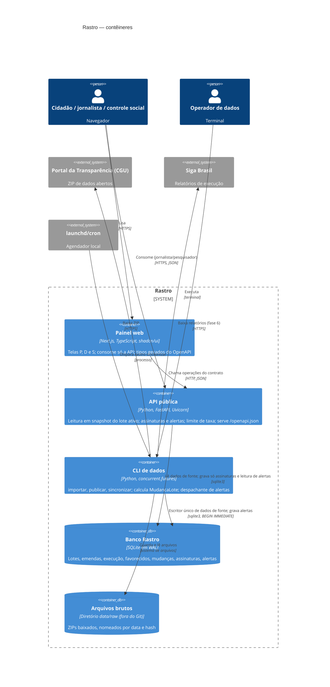

# C4 · Nível 2 — Contêineres

Unidades executáveis e de armazenamento do Rastro (seção 5 do arc42). Tudo roda localmente no macOS (FI-01 §10.3).

## Contêineres

| Contêiner | Tecnologia | Responsabilidade | Contratos | Escreve no banco? |
| :-- | :-- | :-- | :-- | :-- |
| Painel web | Next.js + TypeScript + shadcn/ui | Telas P01–P09, D01, S01–S05; guarda a chave de assinante no `localStorage` | Consome `contratos/openapi.yaml` | Não |
| API pública | FastAPI + Uvicorn | Consultas públicas, assinaturas e alertas; `X-Request-Id`; 429 por IP | Expõe `contratos/openapi.yaml` | Só `Assinante`, `Assinatura` e `Alerta.lido_em` |
| CLI de dados | Python 3.12 (biblioteca padrão `csv`, `zipfile`, `hashlib`, `concurrent.futures`) | ETL, validação, publicação atômica, `MudancaLote`, despachante de alertas | `contratos/cli.md`, `contratos/eventos.asyncapi.yaml` | Sim: dados de fonte, mudanças e alertas |
| Banco Rastro | SQLite (WAL) | Persistência única | `contratos/modelo-de-dados.md` | — |
| Arquivos brutos | Diretório local `data/raw/` | Arquivos originais para reprocessamento e auditoria por hash | — | — |

### Escrita compartilhada entre API e CLI

A API grava apenas tabelas que a CLI não toca (`Assinante`, `Assinatura`, `Alerta.lido_em`). A exceção é `Alerta`:

- A CLI **insere** alertas.
- A API **atualiza** `lido_em`.

As duas operações são transações curtas sob `busy_timeout`, e não há conflito de linha: a inserção nunca altera um alerta existente.

## Componentes principais (nível 3, só para orientar o plano)

| Contêiner | Módulo previsto | Papel |
| :-- | :-- | :-- |
| CLI | `src/rastro/cgu.py` | Leitura em fluxo do ZIP da CGU e validação de linhas |
| CLI | `src/rastro/store.py` | Lotes, publicação atômica e leitura em snapshot (compartilhado com a API) |
| CLI | `src/rastro/mudancas.py` | Cálculo de `MudancaLote` e de `estado_execucao` |
| CLI | `src/rastro/alertas.py` | Despachante: avaliação paralela e inserção idempotente |
| CLI | `src/rastro/sincronizar.py` | Downloads concorrentes e publicação serial |
| API | `src/rastro/api.py` | Rotas FastAPI ↔ operações do `openapi.yaml` |
| Painel | `web/src/app/**` | Uma rota por tela (P01 = `/`, P03 = `/emendas/[codigo]`, …; ver inventário) |
| Painel | `web/src/api/tipos.ts` | Tipos gerados do contrato |

## Implantação

Execução local em macOS, em dois processos de longa duração:

- `uvicorn rastro.api:app` na porta 8000;
- `next start` na porta 3000.

A CLI é executada sob demanda ou pelo `launchd`. O CI (GitHub Actions) roda `pytest`, `ruff`, `tsc --noEmit` e `next lint` a cada push (REQ-51).
