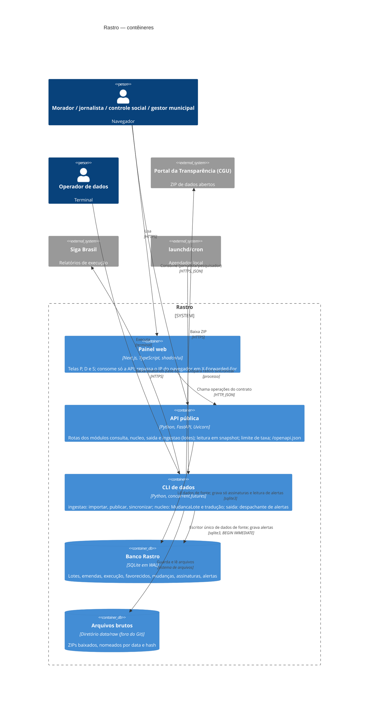

# C4 · Nível 2 — Contêineres

Unidades executáveis e de armazenamento do Rastro (seção 5 do arc42). Tudo roda localmente no macOS (FI-01 §10.3).

## Contêineres

| Contêiner | Tecnologia | Responsabilidade | Módulo | Contratos | Escreve no banco? |
| :-- | :-- | :-- | :-- | :-- | :-- |
| Painel web | Next.js + TypeScript + shadcn/ui | Telas P01–P11, D01, S01–S05; guarda a chave de assinante no `localStorage`; repassa o IP do navegador (`X-Forwarded-For`, REQ-84) | telas P/D = `consulta` (P08 = `nucleo`, P09 = `ingestao` e `nucleo`); telas S = `saida` | Consome `contratos/openapi.yaml` | Não |
| API pública | FastAPI + Uvicorn | Consultas públicas, município, tradução, assinaturas e alertas; `X-Request-Id`; 429 por IP de cliente | `consulta`, `nucleo`, `saida`, `ingestao` (rotas de lotes), conforme `x-modulo` | Expõe `contratos/openapi.yaml` | Só `Assinante`, `Assinatura`, `Alerta` (`lido_em` e exclusão em cascata) (`saida`) e `CacheConsulta` (`consulta`) |
| CLI de dados | Python 3.12 (biblioteca padrão `csv`, `zipfile`, `hashlib`, `concurrent.futures`) | ETL, validação, publicação atômica, `MudancaLote`, tabela de tradução, despachante de alertas | `ingestao` (comandos), `nucleo` (`calcular_mudancas`, `traducao publicar`), `saida` (despachante) | `contratos/cli.md`, `contratos/eventos.asyncapi.yaml` | Sim: dados de fonte, mudanças, tradução e alertas |
| Banco Rastro | SQLite (WAL) | Persistência única, com dono por tabela (ADR-0009) | todos | `contratos/modelo-de-dados.md` | — |
| Arquivos brutos | Diretório local `data/raw/` | Arquivos originais para reprocessamento e auditoria por hash | `ingestao` | — | — |

### Escrita compartilhada entre API e CLI

A API grava `Assinante`, `Assinatura`, `CacheConsulta` e duas coisas em `Alerta`; a CLI grava os dados de fonte, `MudancaLote`, `TabelaTraducao` e insere alertas. O único ponto de contato é `Alerta`:

- A CLI **insere** alertas com `INSERT … SELECT … WHERE EXISTS` na assinatura ativa, então uma assinatura excluída durante o fan-out não quebra a chave estrangeira.
- A API **atualiza** `lido_em` e **apaga** os alertas em cascata quando o assinante exclui a assinatura (REQ-40).

As escritas da API são transações curtas sob `busy_timeout = 5000`. Se uma publicação segurar a trava por mais tempo, a API responde 503 `banco_ocupado` com `Retry-After` (REQ-96), nunca 500.

## Componentes principais (nível 3, só para orientar o plano)

Os componentes ficam na pasta do módulo do grupo que é dono deles (ADR-0009). Nenhum módulo além de `ingestao` importa `ingestao/cgu.py`; `tests/test_fronteiras.py` (`import-linter`) confere.

| Contêiner | Módulo do grupo | Arquivo previsto | Papel |
| :-- | :-- | :-- | :-- |
| CLI | `ingestao` | `src/rastro/ingestao/cgu.py` | Leitura em fluxo do ZIP da CGU, validação de linhas, derivação de `uf_gasto` e `municipio_gasto` |
| CLI | `ingestao` | `src/rastro/ingestao/store.py` | Lotes, publicação atômica e leitura em snapshot (compartilhado com a API) |
| CLI | `ingestao` | `src/rastro/ingestao/sincronizar.py` | Downloads concorrentes e publicação serial |
| CLI | `nucleo` | `src/rastro/nucleo/mudancas.py` | `calcular_mudancas` e view `v_emenda_estado` |
| CLI + API | `nucleo` | `src/rastro/nucleo/traducao.py` | `TabelaTraducao`: publicar versão, ler a vigente, rota `listar_traducoes` |
| API | `consulta` | `src/rastro/consulta/rotas.py` | Rotas de leitura, município e agregações; limite de taxa |
| CLI + API | `saida` | `src/rastro/saida/alertas.py` | Despachante: avaliação paralela e inserção idempotente |
| API | `saida` | `src/rastro/saida/rotas.py` | Assinaturas e alertas |
| API | — | `src/rastro/app.py` | Monta as rotas dos módulos num único FastAPI |
| Painel | por tela | `web/src/app/**` | Uma rota por tela (P01 = `/`, P10 = `/municipios/[uf_gasto]/[municipio_gasto]`, …; ver inventário) |
| Painel | — | `web/src/api/tipos.ts` | Tipos gerados do contrato |

## Implantação

Execução local em macOS, em dois processos de longa duração:

- `uvicorn rastro.app:app` na porta 8000;
- `next start` na porta 3000.

A CLI é executada sob demanda ou pelo `launchd`. O CI (GitHub Actions) roda `pytest`, `ruff`, `tsc --noEmit` e `next lint` a cada push (REQ-51).
