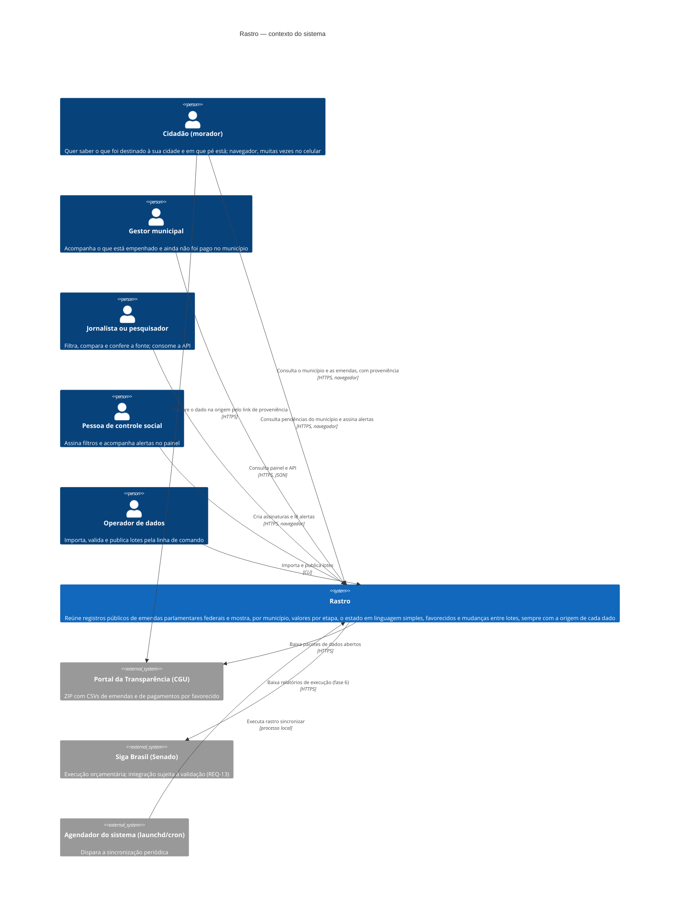

# C4 · Nível 1 — Contexto do sistema

Pessoas e sistemas externos com que o Rastro se relaciona (seção 3 do arc42). A fronteira do sistema é o que o grupo constrói: a CLI de dados, a API, o painel e o banco. A coluna "Telas" da tabela abaixo é a mesma do quadro "Atores × telas" do inventário, e o `verificar.py` confere a igualdade.

## Pessoas e sistemas externos

| Elemento | Tipo | Interage por | O que troca com o Rastro | Telas |
| :-- | :-- | :-- | :-- | :-- |
| Cidadão (morador) | pessoa | painel web (celular e desktop) | Consulta; chave de assinante se quiser alertas (sem dado pessoal, REQ-41) | P01, P02, P03, P04, P05, P07, P09, P10, P11, S01, S02, S03, S04, S05 |
| Jornalista ou pesquisador | pessoa | painel web e API pública | Consulta; limite de 60 req/min por IP de cliente (REQ-28, REQ-84) | P02, P03, P04, P06, P07, P08, P09, P11, D01 |
| Pessoa de controle social | pessoa | painel web | Chave de assinante, filtros e limiares (sem dado pessoal, REQ-41) | P08, S01, S02, S03, S04, S05 |
| Gestor municipal | pessoa | painel web | Consulta; chave de assinante para acompanhar o município | P02, P03, P10, S01, S02, S03, S04, S05 |
| Operador de dados | pessoa | CLI `rastro` na máquina local | Arquivos ZIP baixados, comandos de publicação e versões da tabela de tradução | O01, O02, P09, P11 |
| Portal da Transparência (CGU) | sistema externo | download HTTPS | ZIP Latin-1 `;`: emendas e pagamentos por favorecido | P09 (link de origem) |
| Siga Brasil (Senado) | sistema externo | download HTTPS (a validar) | Valores de execução orçamentária | P03 e P09, quando habilitado |
| Agendador (launchd/cron) | sistema externo | processo local | Disparo de `rastro sincronizar` | — |

## Limites (o que fica fora do sistema)

- O Rastro **não julga** fraude, ilegalidade ou mérito da emenda e não declara a aplicação final do recurso (FI-01 §5; brief).
- O Rastro **não classifica, não pontua e não ranqueia** parlamentares (brief; REQ-71).
- **Não há canal externo de alerta**: sem e-mail, SMS ou push no MVP.
- **Não cobre** emendas estaduais ou municipais (FI-01 §5; brief: fonte e estrutura diferentes), nem anos anteriores a 2025 no MVP (FI-01 §5 e §10.2).
- **Não cruza** com a execução de obra em campo: não há fonte confiável (brief).
- **Não guarda** dados pessoais de usuários (ADR-0005).
- A **aplicação final** do dinheiro (notas, contratos) está fora do contexto: nenhum sistema externo fornece esse dado ao Rastro.
