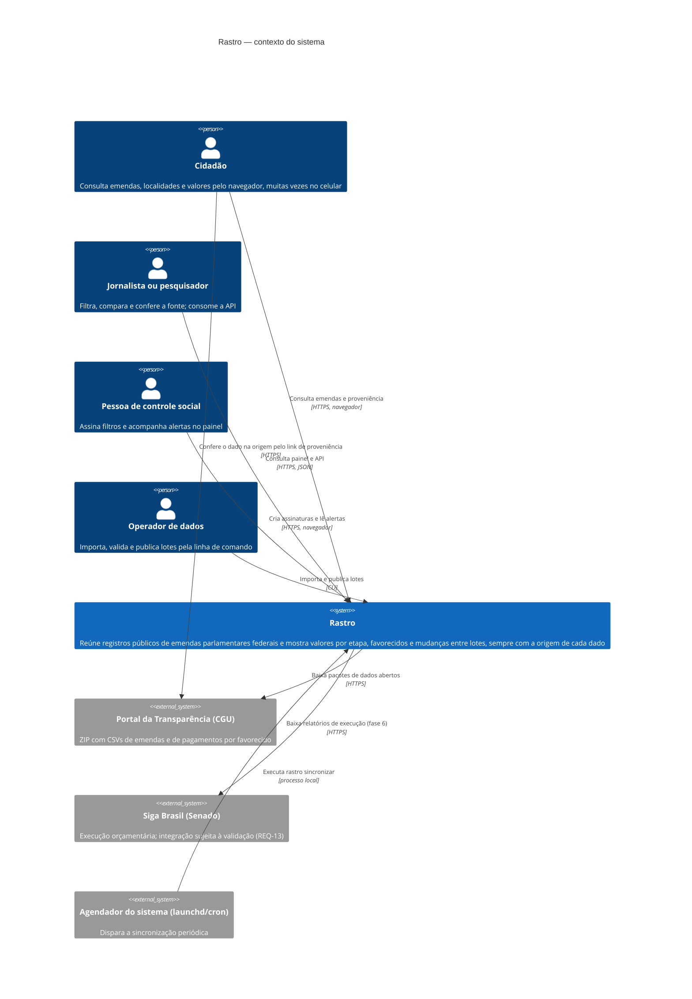

# C4 · Nível 1 — Contexto do sistema

Pessoas e sistemas externos com que o Rastro se relaciona (seção 3 do arc42). A fronteira do sistema é o que o grupo constrói: a CLI de dados, a API, o painel e o banco.

## Pessoas e sistemas externos

| Elemento | Tipo | Interage por | O que troca com o Rastro | Telas |
| :-- | :-- | :-- | :-- | :-- |
| Cidadão | pessoa | painel web (celular e desktop) | Consulta; não fornece dados | P01–P09 |
| Jornalista ou pesquisador | pessoa | painel web e API pública | Consulta; limite de 60 req/min por IP (REQ-28) | P02, P03, P06, P08, P09, D01 |
| Pessoa de controle social | pessoa | painel web | Chave de assinante, filtros e limiares (sem dado pessoal, REQ-41) | S01–S05 |
| Operador de dados | pessoa | CLI `rastro` na máquina local | Arquivos ZIP baixados, comandos de publicação | O01, O02 |
| Portal da Transparência (CGU) | sistema externo | download HTTPS | ZIP Latin-1 `;`: emendas e pagamentos por favorecido | P09 (link de origem) |
| Siga Brasil (Senado) | sistema externo | download HTTPS (a validar) | Valores de execução orçamentária | P03 e P09, quando habilitado |
| Agendador (launchd/cron) | sistema externo | processo local | Disparo de `rastro sincronizar` | — |

## Limites (o que fica fora do sistema)

- O Rastro **não julga** fraude ou ilegalidade e não declara a aplicação final do recurso (FI-01 §5).
- **Não há canal externo de alerta**: sem e-mail, SMS ou push no MVP.
- **Não cobre** emendas estaduais ou municipais, nem anos anteriores a 2025 no MVP.
- **Não guarda** dados pessoais de usuários (ADR-0005).
- A **aplicação final** do dinheiro (notas, contratos) está fora do contexto: nenhum sistema externo fornece esse dado ao Rastro.
