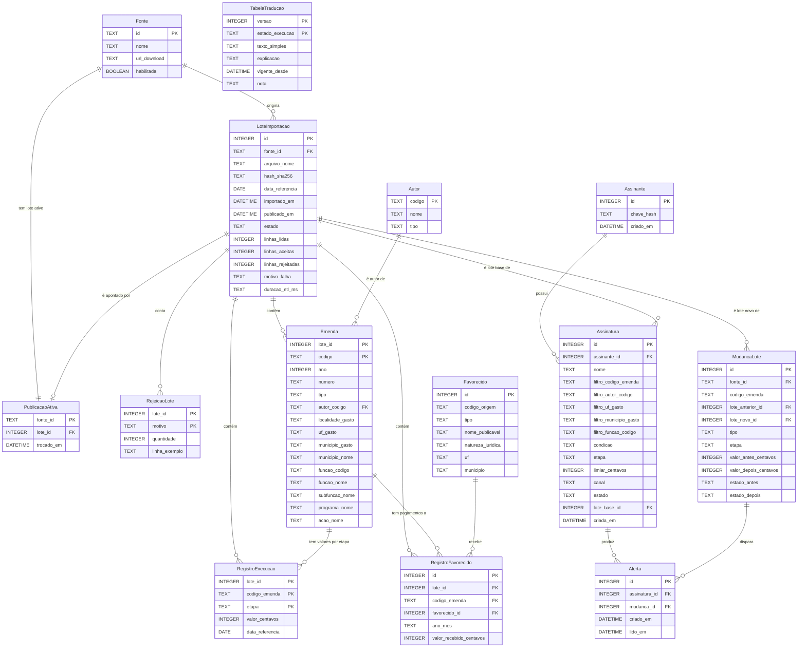

# Modelo de dados

Banco SQLite em modo WAL (ADR-0002). Os nomes abaixo são os mesmos usados nas fichas de tela (`Entidade.campo`), no `openapi.yaml` e no código. Valores monetários são `INTEGER` em centavos; datas seguem ISO 8601.

Regra central (ADR-0001): **dados de fonte nunca são atualizados no lugar**. Cada lote grava as suas próprias linhas (`Emenda`, `RegistroExecucao`, `RegistroFavorecido`), e as consultas leem só o lote indicado por `PublicacaoAtiva`. `Autor` e `Favorecido` são dimensões em que só se insere, nunca se altera.

## Entidades

### Fonte
Origem pública dos dados. As linhas são fixas e criadas na migração: `cgu` (habilitada) e `siga` (desabilitada até a fase 6, REQ-13).

| Campo | Tipo | Restrição | Nota |
| :-- | :-- | :-- | :-- |
| `id` | TEXT | PK, `cgu` \| `siga` | |
| `nome` | TEXT | NOT NULL | "Portal da Transparência (CGU)", "Siga Brasil (Senado)" |
| `url_download` | TEXT | NOT NULL | Página oficial de download, usada como link de proveniência (REQ-14) |
| `habilitada` | BOOLEAN | NOT NULL | REQ-13 |

### LoteImportacao
Um arquivo de uma fonte, importado uma vez e identificado por hash.

| Campo | Tipo | Restrição | Nota |
| :-- | :-- | :-- | :-- |
| `id` | INTEGER | PK autoincremento | Exibido como "Lote #id" |
| `fonte_id` | TEXT | FK → Fonte | |
| `arquivo_nome` | TEXT | NOT NULL | Nome do ZIP baixado |
| `hash_sha256` | TEXT | NOT NULL; índice único parcial (`fonte_id`, `hash_sha256`) `WHERE estado <> 'falhou'` | Base da idempotência (REQ-05, REQ-52, REQ-53) |
| `data_referencia` | DATE | NOT NULL | Data de atualização informada pela fonte |
| `importado_em` | DATETIME | NOT NULL | Data de extração exibida na proveniência (REQ-14) |
| `publicado_em` | DATETIME | NULL até publicar | |
| `estado` | TEXT | `importando` \| `validado` \| `publicado` \| `substituido` \| `recusado` \| `falhou` | Ciclo em `adr/0001` |
| `linhas_lidas` | INTEGER | ≥ 0 | |
| `linhas_aceitas` | INTEGER | ≥ 0 | |
| `linhas_rejeitadas` | INTEGER | ≥ 0 | `lidas = aceitas + rejeitadas` |
| `motivo_falha` | TEXT | NULL \| `formato_alterado` \| `fonte_indisponivel` \| `interrompido` \| `rejeicoes_acima_do_limite` \| `sem_linhas_no_recorte` | REQ-04, REQ-06, REQ-10, REQ-12, REQ-73 |
| `duracao_etl_ms` | TEXT (JSON) | | `{"leitura":…, "validacao":…, "gravacao":…, "publicacao":…}` (REQ-50) |

### RejeicaoLote
Contagem de linhas rejeitadas por motivo (REQ-02, REQ-03).

| Campo | Tipo | Restrição | Nota |
| :-- | :-- | :-- | :-- |
| `lote_id` | INTEGER | PK, FK → LoteImportacao | |
| `motivo` | TEXT | PK, `codigo_invalido` \| `ano_fora_do_recorte` \| `valor_malformado` \| `linha_malformada` \| `emenda_sem_cadastro` | |
| `quantidade` | INTEGER | > 0 | |
| `linha_exemplo` | TEXT | | Primeira linha rejeitada, para diagnóstico |

### PublicacaoAtiva
Ponteiro do lote visível por fonte. Trocar esse ponteiro é a publicação atômica (REQ-07).

| Campo | Tipo | Restrição |
| :-- | :-- | :-- |
| `fonte_id` | TEXT | PK, FK → Fonte |
| `lote_id` | INTEGER | FK → LoteImportacao, estado `publicado` |
| `trocado_em` | DATETIME | NOT NULL |

### Autor
Dimensão em que só se insere.

| Campo | Tipo | Restrição | Coluna CGU |
| :-- | :-- | :-- | :-- |
| `codigo` | TEXT | PK | Código do Autor da Emenda |
| `nome` | TEXT | NOT NULL | Nome do Autor da Emenda |
| `tipo` | TEXT | `parlamentar` \| `bancada` \| `comissao` \| `relator` \| `outro` | Derivado de Tipo de Emenda (REQ-22) |

### Emenda
Cadastro da emenda **no lote** (PK composta), para que nenhum atributo mude sob um leitor.

| Campo | Tipo | Restrição | Coluna CGU |
| :-- | :-- | :-- | :-- |
| `lote_id` | INTEGER | PK, FK → LoteImportacao | — |
| `codigo` | TEXT | PK, 12 dígitos | Código da Emenda |
| `ano` | INTEGER | = 2025 no MVP | Ano da Emenda |
| `numero` | TEXT | | Número da emenda |
| `tipo` | TEXT | NOT NULL | Tipo de Emenda |
| `autor_codigo` | TEXT | FK → Autor | Código do Autor da Emenda |
| `localidade_gasto` | TEXT | | Localidade do gasto (texto original) |
| `uf_gasto` | TEXT | NULL = nacional/múltiplas | Derivado de `localidade_gasto` (REQ-21, REQ-78) |
| `municipio_gasto` | TEXT | NULL quando a localidade é UF, região ou nacional (REQ-88) | Identificador derivado de `localidade_gasto` na forma "MUNICÍPIO - UF": minúsculo, sem acento, com hífens (`joao-pessoa`) (REQ-66) |
| `municipio_nome` | TEXT | NULL junto com `municipio_gasto` | Nome do município como publicado ("João Pessoa") (REQ-66) |
| `funcao_codigo` / `funcao_nome` | TEXT | | Código Função / Nome Função |
| `subfuncao_nome` | TEXT | | Nome Subfunção |
| `programa_nome` | TEXT | | Nome Programa |
| `acao_nome` | TEXT | | Nome Ação |
| `estado_execucao` | — | derivado (view `v_emenda_estado`), não armazenado | ADR-0006 |
| `estado_texto` / `traducao_versao` | — | derivados na API (junção com a versão vigente de `TabelaTraducao`) | REQ-69 |

Índices: (`lote_id`, `autor_codigo`), (`lote_id`, `uf_gasto`, `municipio_gasto`), (`lote_id`, `funcao_codigo`), (`lote_id`, `tipo`).

### RegistroExecucao
Valor acumulado de uma etapa de uma emenda num lote. A sequência entre lotes forma a linha do tempo (REQ-23).

| Campo | Tipo | Restrição | Coluna CGU |
| :-- | :-- | :-- | :-- |
| `lote_id` | INTEGER | PK, FK | — |
| `codigo_emenda` | TEXT | PK | Código da Emenda |
| `etapa` | TEXT | PK, `empenhado` \| `liquidado` \| `pago` \| `rap_inscrito` \| `rap_cancelado` \| `rap_pago` | Valor Empenhado · Valor Liquidado · Valor Pago · Valor Restos a Pagar Inscritos · Cancelados · Pagos |
| `valor_centavos` | INTEGER | ≥ 0 | Convertido de `1.234,56` (REQ-03) |
| `data_referencia` | DATE | = `LoteImportacao.data_referencia` | |

**Estado de execução** (derivado, ADR-0006): `estado_execucao` é calculado na view `v_emenda_estado` a partir da etapa mais avançada com valor > 0. A ordem é `sem_execucao` < `empenhada` < `liquidada` < `paga` (`pago` + `rap_pago` > 0).

### Favorecido
Dimensão em que só se insere. UNIQUE (`codigo_origem`, `nome_publicavel`).

| Campo | Tipo | Restrição | Coluna CGU (arquivo por favorecido) |
| :-- | :-- | :-- | :-- |
| `id` | INTEGER | PK | — |
| `codigo_origem` | TEXT | NOT NULL | Código do Favorecido (CNPJ; CPF já mascarado pela CGU, `***.123.456-**`) |
| `tipo` | TEXT | `pessoa_fisica` \| `pessoa_juridica` \| `ente_publico` \| `outro` | Tipo Favorecido |
| `nome_publicavel` | TEXT | NOT NULL | Favorecido, como publicado (ADR-0007) |
| `natureza_juridica` | TEXT | | Natureza Jurídica |
| `uf` / `municipio` | TEXT | | UF Favorecido / Município Favorecido. **Não** é o local do gasto (REQ-21) |

### RegistroFavorecido
Valor recebido por um favorecido num mês, num lote.

| Campo | Tipo | Restrição | Coluna CGU |
| :-- | :-- | :-- | :-- |
| `id` | INTEGER | PK | — |
| `lote_id` | INTEGER | FK | — |
| `codigo_emenda` | TEXT | FK (`lote_id`, `codigo_emenda`) → Emenda | Código da Emenda |
| `favorecido_id` | INTEGER | FK → Favorecido | — |
| `ano_mes` | TEXT | `AAAA-MM` | Ano/Mês |
| `valor_recebido_centavos` | INTEGER | ≥ 0 | Valor Recebido |

### MudancaLote
Diferença entre dois lotes da mesma fonte, calculada na publicação (REQ-08, ADR-0004).

| Campo | Tipo | Restrição | Nota |
| :-- | :-- | :-- | :-- |
| `id` | INTEGER | PK | |
| `fonte_id` | TEXT | FK | |
| `codigo_emenda` | TEXT | NOT NULL | |
| `lote_anterior_id` | INTEGER | FK, NOT NULL | O primeiro lote de uma fonte não gera mudanças (REQ-08) |
| `lote_novo_id` | INTEGER | FK | |
| `tipo` | TEXT | `nova_emenda` \| `valor_alterado` \| `estado_alterado` | |
| `etapa` | TEXT | Preenchida só em `valor_alterado`; NULL em `nova_emenda` (uma linha por emenda nova) e em `estado_alterado` | REQ-63 lê o valor da emenda nova em `RegistroExecucao` |
| `valor_antes_centavos` / `valor_depois_centavos` | INTEGER | NULL quando não se aplica | |
| `estado_antes` / `estado_depois` | TEXT | valores de `estado_execucao` | |
| `autor_nome` / `uf_gasto` / `municipio_gasto` / `municipio_nome` / `estado_antes_texto` / `estado_depois_texto` / `traducao_versao` | — | derivados na API (junção com `Emenda`, `Autor` e a versão vigente de `TabelaTraducao`), não armazenados | P08, S05; REQ-69 |

Índice único de expressão (`lote_novo_id`, `codigo_emenda`, `tipo`, `COALESCE(etapa, '-')`), porque no SQLite valores NULL não colidem num UNIQUE comum.

### Assinante
Identidade anônima (ADR-0005). Sem nenhum dado pessoal (REQ-41).

| Campo | Tipo | Restrição |
| :-- | :-- | :-- |
| `id` | INTEGER | PK |
| `chave_hash` | TEXT | UNIQUE, SHA-256 da chave |
| `criado_em` | DATETIME | NOT NULL |

### Assinatura

| Campo | Tipo | Restrição | Nota |
| :-- | :-- | :-- | :-- |
| `id` | INTEGER | PK | |
| `assinante_id` | INTEGER | FK → Assinante | Até 20 por assinante (REQ-42) |
| `nome` | TEXT | 1–80 caracteres | Rótulo dado pelo assinante |
| `filtro_codigo_emenda` | TEXT | NULL ou 12 dígitos | |
| `filtro_autor_codigo` | TEXT | NULL ou FK → Autor | |
| `filtro_uf_gasto` | TEXT | NULL, sigla de UF ou `NM` | `NM` = nacional ou múltiplas UFs (REQ-78) |
| `filtro_municipio_gasto` | TEXT | NULL, ou identificador de município com `filtro_uf_gasto` de uma UF (CHECK) | "Acompanhar este município" (P10, REQ-87) |
| `filtro_funcao_codigo` | TEXT | NULL ou código | Pelo menos um filtro preenchido (REQ-34) |
| `condicao` | TEXT | `limiar_valor` \| `mudanca_estado` | |
| `etapa` | TEXT | obrigatória se `limiar_valor` | |
| `limiar_centavos` | INTEGER | > 0 se `limiar_valor` | |
| `canal` | TEXT | = `painel` | Único canal do MVP (FI-01 §10.2) |
| `estado` | TEXT | `ativa` \| `pausada` | REQ-38 |
| `lote_base_id` | INTEGER | FK → LoteImportacao | REQ-37 |
| `criada_em` | DATETIME | NOT NULL | |
| `descricao` | — | derivado na API, não armazenado | Resumo legível com os rótulos do lote ativo (S04) |
| `alertas_total` / `alertas_nao_lidos` | — | derivados na API (COUNT de `Alerta`) | S04, REQ-40 |

### Alerta

| Campo | Tipo | Restrição |
| :-- | :-- | :-- |
| `id` | INTEGER | PK |
| `assinatura_id` | INTEGER | FK → Assinatura, ON DELETE CASCADE |
| `mudanca_id` | INTEGER | FK → MudancaLote |
| `criado_em` | DATETIME | NOT NULL |
| `lido_em` | DATETIME | NULL = não lido |
| `assinatura_condicao` / `assinatura_etapa` / `assinatura_limiar_centavos` | — | derivados na API (junção com `Assinatura`), não armazenados |

O FI-01 §9 previa `Alerta.estado`. Ele foi substituído por `lido_em`: o único estado do alerta no MVP é lido ou não lido, e a data atende à idempotência do REQ-39.

UNIQUE (`assinatura_id`, `mudanca_id`): garante "no máximo um alerta por mudança e assinatura" (REQ-36).

### TabelaTraducao
Tradução do estado de execução para linguagem simples, **versionada e auditável** (brief do grupo; ADR-0008). Só se insere: uma versão nova nunca altera as anteriores (REQ-70). PK (`versao`, `estado_execucao`).

| Campo | Tipo | Restrição | Nota |
| :-- | :-- | :-- | :-- |
| `versao` | INTEGER | PK, ≥ 1 | A maior versão é a vigente |
| `estado_execucao` | TEXT | PK, `sem_execucao` \| `empenhada` \| `liquidada` \| `paga` | Uma linha por estado em cada versão (REQ-86) |
| `texto_simples` | TEXT | NOT NULL, ≤ 60 caracteres | O que o morador lê no lugar do termo técnico |
| `explicacao` | TEXT | NOT NULL, ≤ 280 caracteres | Uma frase que liga o texto ao termo técnico |
| `vigente_desde` | DATETIME | NOT NULL | Momento de `rastro traducao publicar` |
| `nota` | TEXT | | Motivo da versão |

Versão 1, carregada na migração inicial:

| `estado_execucao` | `texto_simples` | `explicacao` |
| :-- | :-- | :-- |
| `sem_execucao` | Ainda sem dinheiro reservado | Nenhum valor foi empenhado para esta emenda até a data dos dados. |
| `empenhada` | O dinheiro foi reservado | Houve empenho: o orçamento separou o valor, mas a entrega ainda não foi conferida. |
| `liquidada` | A entrega foi conferida; falta pagar | Houve liquidação: o governo reconheceu que o bem ou serviço foi entregue. |
| `paga` | Já houve pagamento registrado | Houve pagamento registrado. Isso não comprova a aplicação final do recurso. |

Gatilho `BEFORE UPDATE` e `BEFORE DELETE` em `TabelaTraducao` que aborta a operação: versões publicadas são imutáveis no próprio schema.
