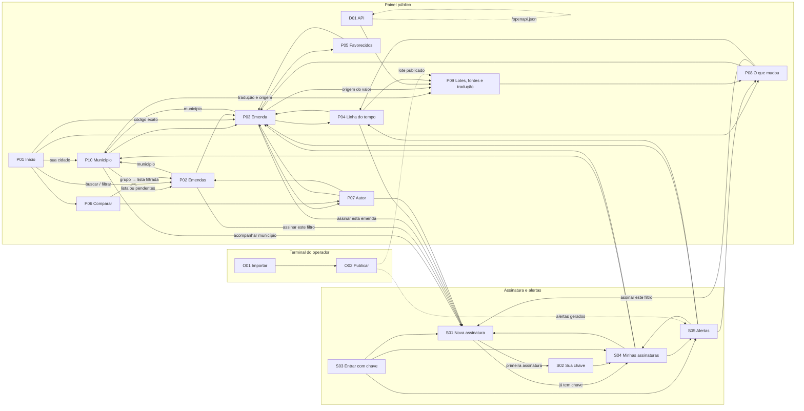

# Inventário e navegação — Rastro

18 telas, cinco atores e três superfícies. Os ids são estáveis e citados nas fichas, na coluna "Telas" de `../arquitetura/requisitos.md` (gerada por `verificar.py`) e em `../arquitetura/rastreabilidade.md`. Os atores seguem o brief do grupo: morador (cidadão), jornalista ou controle social e gestor municipal, mais o operador de dados.

Prefixos: **P** = painel público · **D** = desenvolvedores (API) · **S** = assinatura e alertas · **O** = operador (CLI).

## Quadro de telas

| ID | Tela | Ator principal | Superfície | Rota / comando | Ficha |
| :-- | :-- | :-- | :-- | :-- | :-- |
| P01 | Início | Cidadão (morador) | Painel web | `/` | [P01-inicio.md](P01-inicio.md) |
| P02 | Emendas: busca e filtros | Cidadão, jornalista, gestor municipal | Painel web | `/emendas` | [P02-emendas.md](P02-emendas.md) |
| P03 | Emenda | Cidadão, jornalista, gestor municipal | Painel web | `/emendas/[codigo]` | [P03-emenda.md](P03-emenda.md) |
| P04 | Linha do tempo da emenda | Cidadão, jornalista, controle social | Painel web | `/emendas/[codigo]/linha-do-tempo` | [P04-linha-do-tempo.md](P04-linha-do-tempo.md) |
| P05 | Favorecidos da emenda | Cidadão, jornalista | Painel web | `/emendas/[codigo]/favorecidos` | [P05-favorecidos.md](P05-favorecidos.md) |
| P06 | Comparar por autor, UF ou função | Jornalista | Painel web | `/comparar` | [P06-comparar.md](P06-comparar.md) |
| P07 | Autor | Cidadão, jornalista | Painel web | `/autores/[codigo]` | [P07-autor.md](P07-autor.md) |
| P08 | O que mudou | Jornalista, controle social | Painel web | `/mudancas` | [P08-o-que-mudou.md](P08-o-que-mudou.md) |
| P09 | Lotes, fontes e tradução | Cidadão, jornalista, operador | Painel web | `/dados` | [P09-lotes-e-fontes.md](P09-lotes-e-fontes.md) |
| P10 | Município | Cidadão (morador), gestor municipal | Painel web | `/municipios/[uf]/[municipio]` | [P10-municipio.md](P10-municipio.md) |
| D01 | API para jornalistas e pesquisadores | Jornalista ou pesquisador | Painel web + API pública | `/api-docs` | [D01-api.md](D01-api.md) |
| S01 | Nova assinatura | Controle social, cidadão, gestor municipal | Painel web | `/assinaturas/nova` | [S01-nova-assinatura.md](S01-nova-assinatura.md) |
| S02 | Sua chave de assinante | Controle social | Painel web | `/assinaturas/chave` | [S02-chave.md](S02-chave.md) |
| S03 | Entrar com chave | Controle social | Painel web | `/entrar` | [S03-entrar.md](S03-entrar.md) |
| S04 | Minhas assinaturas | Controle social, gestor municipal | Painel web | `/assinaturas` | [S04-minhas-assinaturas.md](S04-minhas-assinaturas.md) |
| S05 | Alertas | Controle social, cidadão e gestor municipal (assinantes) | Painel web | `/alertas` | [S05-alertas.md](S05-alertas.md) |
| O01 | Importar e validar lote | Operador de dados | CLI (terminal) | `rastro importar` | [O01-importar.md](O01-importar.md) |
| O02 | Publicar lote | Operador de dados | CLI (terminal) | `rastro publicar` | [O02-publicar.md](O02-publicar.md) |

## Cobertura

### Atores × telas

| Ator | Telas | Fluxos principais cobertos |
| :-- | :-- | :-- |
| Cidadão (morador) | P01, P02, P03, P04, P05, P07, P09, P10, S01, S05 | F9 ver minha cidade · F1 consultar · F7 conferir origem · F4 assinar (FI-01 §4.2 #4 e #6) |
| Jornalista ou pesquisador | P02, P03, P04, P06, P07, P08, P09, D01 | F1 · F2 comparar · F3 acompanhar mudanças · F8 usar a API |
| Pessoa de controle social | P08, S01, S02, S03, S04, S05 | F4 assinar · F5 receber e ler alerta |
| Gestor municipal | P02, P03, P10, S01, S04, S05 | F10 acompanhar pendências do município |
| Operador de dados | O01, O02, P09 | F6 importar e publicar |

### Superfícies × telas

| Superfície | Telas |
| :-- | :-- |
| Painel web (celular e desktop) | P01–P10, D01, S01–S05 |
| API pública (JSON) | D01 documenta; todas as telas P, D e S a consomem |
| CLI do operador (terminal) | O01, O02 |

### Funcionalidades do FI-01 §4.2 × telas

| # | Funcionalidade | Telas |
| :-- | :-- | :-- |
| 1 | Importar e validar dados (CGU; Siga opcional) | O01, O02, P09 |
| 2 | Consultar emendas e agregações por autor, UF e função via API | P02, P06, P07, D01 |
| 3 | Navegar no painel com filtros e links de proveniência | P01, P02, P03, P09 |
| 4 | Linha do tempo empenho → liquidação → pagamento | P04 |
| 5 | O que mudou desde o último lote | P08 |
| 6 | Assinar filtro e limiar ou mudança de estado | S01, S02, S03, S04 |
| 7 | Alerta no painel, uma vez por mudança confirmada | S05 (gerado em O02) |

### Exigências do brief do grupo × telas

| Exigência do brief (`ddea-ufpb/rastro`) | Telas | Requisitos |
| :-- | :-- | :-- |
| Consulta por município ("o que foi destinado à cidade dele") | P01, P10, P02, S01 | REQ-66, REQ-67 |
| Estado traduzido para linguagem simples, por tabela versionada e auditável | P02, P03, P04, P10, S05, P09 (tabela) | REQ-69, REQ-70, ADR-0008 |
| Gestor municipal: "o que está empenhado mas não executado" | P10, P02 (`pendentes`) | REQ-68 |
| Toda informação com fonte, lote e data de extração | todas as telas do painel | REQ-14, REQ-48 |
| Não classifica, não pontua, não ranqueia parlamentares | P06, P07, P10 | REQ-71 |
| Assinatura por filtro e limiar, entrega única por assinante | S01–S05, O02 | REQ-35, REQ-36, REQ-63 |
| Cadastro só o necessário para a assinatura | S01, S02, S03 | REQ-41, ADR-0005 |

## Mapa de navegação

Navegação global (cabeçalho, em todas as telas do painel): P01 · P02 · P06 · P08 · P09 · D01 · busca (código → P03, cidade → P10, texto → P02) · "Alertas" (S05 com chave; S03 sem chave). A faixa "Dados de … · Lote #n" leva a P09.

## Fluxos principais

| Fluxo | Sequência | Ator |
| :-- | :-- | :-- |
| F1 Consultar uma emenda | P01 → P02 → P03 → P05 | Cidadão |
| F2 Comparar e aprofundar | P01 → P06 → P07 → P03 → P04 | Jornalista |
| F3 Acompanhar mudanças | P08 → P03 → P04 | Jornalista, controle social |
| F4 Assinar | P02 ou P03 ou P08 → S01 → S02 (1ª vez) → S04 | Controle social |
| F5 Ler alerta (outro dispositivo) | S03 → S05 → P03 / P08 | Controle social |
| F6 Importar e publicar | O01 → O02 → (P09 atualizado, S05 recebe alertas) | Operador |
| F7 Conferir a origem | qualquer valor em P → P09 → download oficial da CGU | Cidadão, jornalista |
| F8 Usar a API | D01 → `GET /api/...` | Jornalista ou pesquisador |
| F9 Ver minha cidade | P01 → P10 → P03 (estado em linguagem simples) → P09 (tradução) | Cidadão (morador) |
| F10 Acompanhar pendências do município | P10 → "Empenhadas e ainda não pagas" → P02 (CSV) → S01 → S05 | Gestor municipal |
